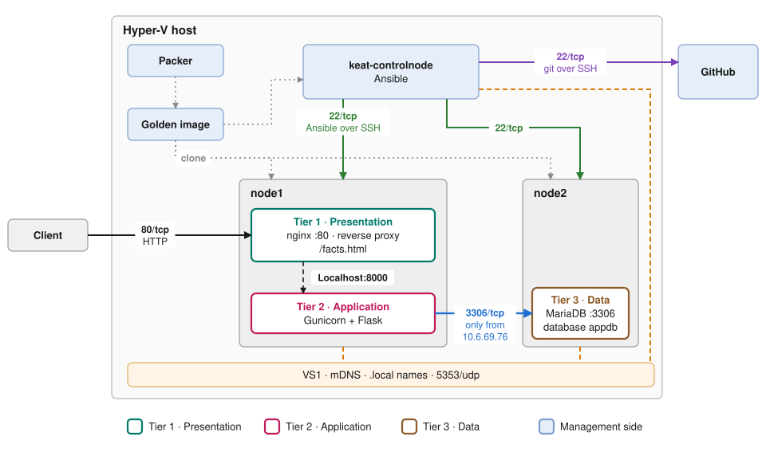

# Infrastructure topology

Three VMs on one Hyper-V host: a control node that configures the others, and two servers that run the application in three tiers.

## Tiers

| Tier | Role | Component | Host |
|---|---|---|---|
| 1 · Presentation | Accepts HTTP from clients, serves static files | nginx :80, reverse proxy, `/facts.html` | keat-node1 |
| 2 · Application | Runs the application logic, reads from the database | Gunicorn + Flask on 127.0.0.1:8000, settings in `/etc/app.env` | keat-node1 |
| 3 · Data | Stores the data | MariaDB :3306, database `appdb` | keat-node2 |

The tiers are logical layers, not machines: tiers 1 and 2 share keat-node1. Each tier only talks to the next one: client to tier 1 on port 80, tier 1 to tier 2 on 127.0.0.1:8000, tier 2 to tier 3 on port 3306.

The control node, Packer, the golden image and GitHub are the management side. They build and configure the tiers but serve no requests.

## Connections

| From | To | Port | Purpose |
|---|---|---|---|
| Client | nginx on keat-node1 | 80/tcp | HTTP |
| nginx | Gunicorn on keat-node1 | 127.0.0.1:8000 | Reverse proxy, not reachable from the network |
| Gunicorn | MariaDB on keat-node2 | 3306/tcp | Database, accepted only from 10.6.69.76 |
| keat-controlnode | keat-node1, keat-node2 | 22/tcp | Ansible over SSH |
| keat-controlnode | GitHub | 22/tcp | git over SSH |
| All three VMs | VS1 | 5353/udp | mDNS, `.local` names |

ufw on keat-node1 and keat-node2 denies all other incoming traffic. The addresses are the DHCP leases from the verified run.

## Editing the diagram

`topology.drawio.svg` is an SVG with the draw.io diagram embedded. Open it in [diagrams.net](https://app.diagrams.net) or in VS Code with the draw.io extension, edit it, and save it under the same name so GitHub keeps showing it as an image.
